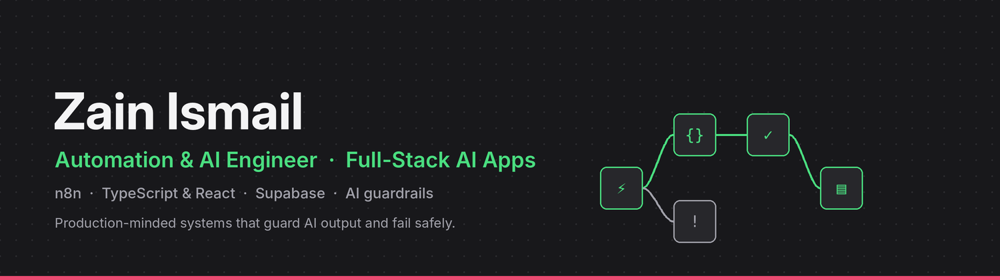
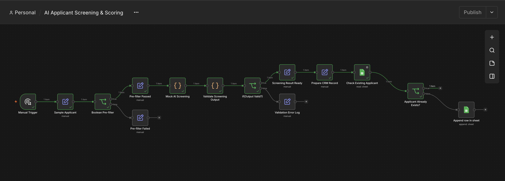

  

  
  <!--  -->
  
  

## About me

I'm **Zain Ismail**, an automation and AI engineer. I build two kinds of systems:

- **Workflow automations in n8n** that connect business tools, such as hiring pipelines, CRM syncs and failure triage
- **Full-stack AI applications** in TypeScript, React and Supabase, with multi-tenant data, server-side AI and real access control

What ties my work together is reliability. Most automations work on the happy path and fail silently everywhere else; I design the rest of the system:

- **Input contracts:** every webhook payload and AI response is validated before it can change state
- **Failure design:** every branch has a defined outcome, and errors are classified, logged and explained
- **Idempotency and bounded retries:** safe to re-run, with no duplicate records and no infinite loops
- **Security by default:** server-side secrets, row-level security, and authorization before every AI call
- **Operability:** documented APIs, honest limitations, and clear setup for the next engineer

---

## Featured projects

### 🎧 SupportPilot: AI-Assisted Helpdesk &nbsp;·&nbsp; *full-stack SaaS*
A multi-tenant customer-support platform with a shared inbox, SLA tracking, knowledge base, analytics and an **AI Copilot** that summarizes threads, triages sentiment and intent, and drafts replies.

- **Tenant isolation in the database:** row-level security on 14 tables with 39 policies
- **AI behind server-side authorization:** session, membership and organization checks run before every model call; keys never reach the browser
- **Prompt-injection aware prompts** and Zod-validated request contracts
- **CI on every push** (tests, lint, build) and 7 versioned SQL migrations with audit triggers

`TypeScript` `React` `TanStack Start` `Supabase` `PostgreSQL` `Tailwind` `OpenAI API` · **[Code & architecture →](https://github.com/zainismail-dev/compass-ai-helpdesk)**

### 🧑‍💼 AI Applicant Screening & Scoring &nbsp;·&nbsp; *n8n*
Automates first-round hiring. A deterministic pre-filter runs before AI scoring, a validation gate checks every AI result, and a lookup-before-write step keeps the Google Sheets CRM free of duplicates.

| Engineering decision | Why it matters |
|---|---|
| Rules before AI | Cuts model cost and keeps rejections explainable |
| AI output treated as untrusted | A malformed response can never corrupt candidate data |
| Check-then-append | Re-runs and retries never create duplicate candidates |
| Explicit failure branches | Rejected and invalid records are logged, never dropped |

`n8n` `JavaScript` `Google Sheets` `LLM guardrails` · **[Architecture & docs →](https://github.com/zainismail-dev/ai-applicant-screening)**

### 🛡️ FlowGuard AI: Automation Failure Detective &nbsp;·&nbsp; *n8n*
A webhook service with a typed request contract. It classifies failed automations (auth, permission, not-found, rate-limit, 5xx, timeout, bad payload) and returns a structured diagnosis with severity, confidence, evidence and remediation steps. Confirmed facts are kept separate from inferred causes.

`n8n` `JavaScript` `REST/Webhooks` `Incident triage` · **[API reference →](https://github.com/zainismail-dev/flowguard-ai)**

### 🔁 n8n Automation Portfolio &nbsp;·&nbsp; *reliability patterns*
Focused, importable workflows that each demonstrate one production pattern, starting with retry and backoff under a hard attempt cap, tested against both recovery and permanent-failure scenarios.

`n8n` `JavaScript` `Error handling` · **[Browse workflows →](https://github.com/zainismail-dev/n8n-automation-portfolio)**

---

## What I can build for you

| Area | Examples |
|---|---|
| **AI-powered web apps** | Helpdesks, dashboards and internal tools with auth, multi-tenancy and server-side AI |
| **Workflow automation** | Hiring pipelines, lead routing, CRM and e-commerce syncs, reporting |
| **AI workflow engineering** | LLM steps with structured output, validation gates and safe fallbacks |
| **Reliability** | Input validation, error classification, bounded retries, idempotent writes, monitoring |
| **Documentation** | API contracts, architecture notes and runbooks your team can hand over |

## Tech stack

**Automation:** &nbsp;

**Frontend:** &nbsp;

**Backend & data:** &nbsp;

**Quality & tooling:** &nbsp;

## Currently building

- Connecting SupportPilot's ticket screens to live, per-organization data
- Replacing the mock scoring step in Applicant Screening with a live LLM returning structured JSON
- Persistent incident history and a recurring-failure dashboard for FlowGuard

---

<b>Hiring, or have a process that eats hours every week?</b> 
Email me at <a href="mailto:zm48713@gmail.com">zm48713@gmail.com</a>.

